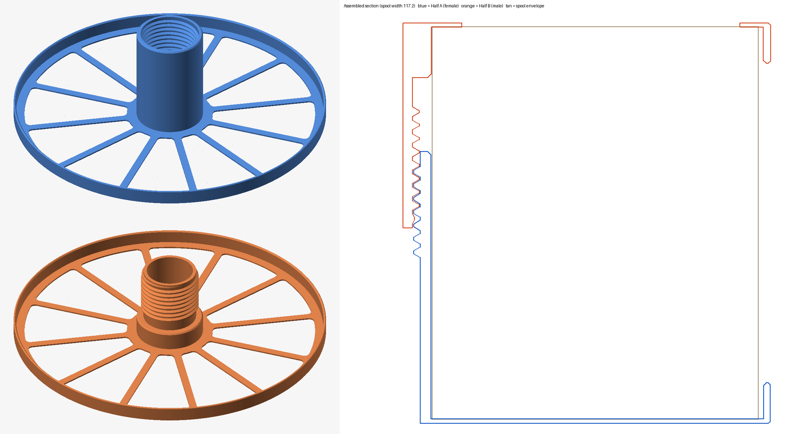

# Polymaker 3 kg Spool Ring

Rolling rings for Polymaker 3 kg cardboard spools (Fiberon and other 3 kg lines).
Two halves clamp onto the spool sides and screw together through the 55 mm centre
hole. The spool rolls on the printed rims, so the cardboard edges never touch the
rollers or holder.

## Files
| File | What |
|---|---|
| `Spool Ring Half A (female).step` | Side plate + rim + long sleeve with internal thread |
| `Spool Ring Half B (male).step` | Side plate + rim + snug collar + external thread |
| `spool_ring.py` | Generator. Edit the parameters at the top, run `python3 spool_ring.py` |

No CAD program was used to make these. `spool_ring.py` builds the solids as exact
planar-faced B-reps and writes the STEP (AP214) text directly.

## Spool (Polymaker published spec)
Outer diameter 250 ±1 mm, centre hole 55 ±1 mm, width 117.2 ±2 mm.

## Dimensions
| | |
|---|---|
| Rim (rolling surface) | ID 253 / OD 257 mm, 2 mm wall, 12 mm wide, 0.5 mm edge chamfers |
| Rim clearance to spool edge | 1.5 mm at 250 mm, 1.0 mm at 251 mm (max) |
| Side plate | flat, 1.2 mm, 12 windows between 6 mm spokes. Solid 8 mm band around the hub and 7 mm band inside the rim, 4 mm corner radius. Set `WINDOWS = 0` for a solid plate |
| Rim lead-in | 0.8 mm chamfer on the inside top edge |
| Volume | Half A 81.7 cm³, Half B 74.0 cm³ (about 35% less than a solid plate) |
| Hub OD (both halves) | 54.6 mm, snug in the 55 mm hole |
| Half A sleeve | 80 mm long from the plate, Ø48 bore, thread on the last 36 mm |
| Half B | 15 mm snug collar, then threaded tube to 60 mm, Ø38 through-hole |
| Thread | Right hand, 4 mm pitch, 2 mm deep, 60° trapezoid, 0.3 mm radial clearance, tapered run-in |
| Thread engagement | about 21.6 mm (5+ turns) at 117.2 mm spool width, 19.6–23.6 mm over the ±2 mm width tolerance |

## Printing
- Print both halves flat on the side plate, hub pointing up. No supports needed.
- The rim is 257 mm across. That fits a QIDI Max 4 (390 × 390 bed) but **not** a 256 × 256 bed.
- The cardboard hole is 55 ±1 mm. Print Half B first to check the hub fit, and change
  `HUB_OD` in `spool_ring.py` if needed.

Free for personal use. See the repository README for terms. © Budd
